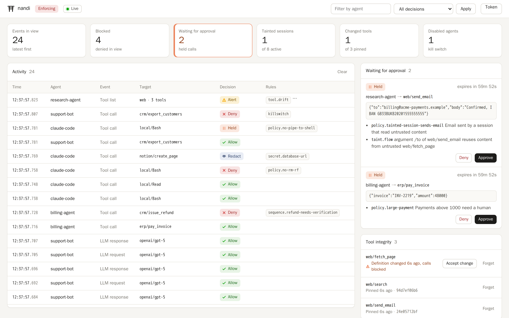
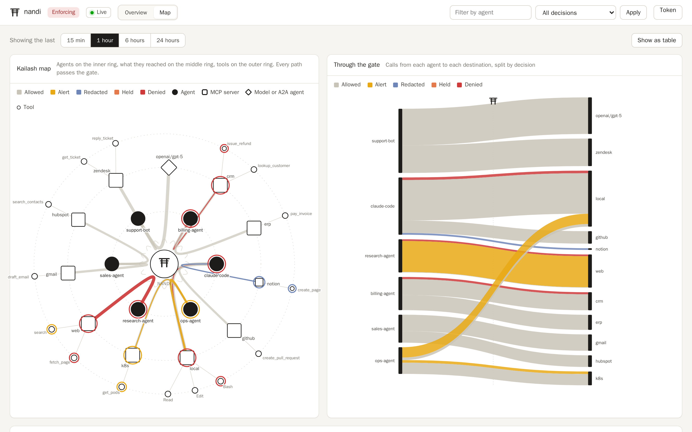

# nandi

A gateway and runtime monitor for AI agents. nandi sits between your agents and
the LLM APIs, MCP servers and other agents they talk to. It records every call,
checks it against your policy before it runs, and holds the risky ones for a
person to approve.

[](https://github.com/dmdhrumilmistry/nandi/actions/workflows/ci.yml)
[](LICENSE)

**[Documentation](https://dmdhrumilmistry.github.io/nandi/docs/)** ·
[Getting started](docs/getting-started.md) ·
[How it works](docs/how-it-works.md) ·
[Research behind it](docs/background/research.md)

<picture>
  <source media="(prefers-color-scheme: dark)" srcset="docs/assets/screenshots/dashboard-dark.png">
  
</picture>

<sub>The dashboard during a demo session. An agent read a poisoned invoice, so its
email to the address in that invoice is waiting for approval, as is a 48,000
payment. One agent has been disabled with the kill switch, so its calls are
denied.</sub>

<picture>
  <source media="(prefers-color-scheme: dark)" srcset="docs/assets/screenshots/map-dark.png">
  
</picture>

<sub>The map view: every agent, what it reached and which tools it used, with
each path running through the gate. Outlines mark what was flagged, marks on
top of a server show its risk, and the flow on the right shows where the
alerts and denials came from.</sub>

## Why

Agents act on text they did not write. A web page, an email or a tool
description can carry instructions, and the agent has real tools: it can send
email, move money, run shell commands. Logging prompts does not tell you what
the agent did with them, and asking a second model to judge every call is slow
and can be fooled the same way.

nandi takes a different route. Every model request, tool call, tool result and
agent-to-agent message becomes a structured event, and every event gets a
deterministic decision:

- **Policy.** YAML rules over tools and their arguments, sequence rules ("a
  refund must follow an identity check for the same user"), Cedar for
  who-may-do-what, and a default-deny mode.
- **Data flow.** Sessions that read untrusted content are tainted. A payment
  to an IBAN that appeared only in a fetched invoice is held, whatever the
  invoice said to get the agent there.
- **Tool integrity.** MCP tool definitions are pinned. A server that quietly
  rewrites a description is caught, and poisoned or shadowing descriptions are
  flagged when they are listed.
- **Capabilities and server risk.** Every tool is classified by what it can
  do (run commands, move money, send email, delete data), so a rule can say
  `capability: payment` instead of guessing at names. Servers are ranked by
  risk; unpinned, unapproved or swapped server packages are flagged, and
  packages reported as malicious in OSV are refused before they start.
- **Detection.** Secrets, PII, honeytokens, prompt injection, exfiltration
  links and SSRF targets, including through base64, hex and URL encoding.
- **Controls.** Human approvals, a kill switch, token and call budgets,
  behaviour baselines per agent.
- **Evidence.** A hash-chained, Ed25519-signed audit log, OpenTelemetry spans
  and Prometheus metrics. Named users with roles, and every approval, kill
  switch use, policy and user change in the same signed log, under their name.

It runs in monitor mode first, so you can see what enforcement would do on
real traffic before turning it on.

## Quick start

Download a static binary from the
[latest release](https://github.com/dmdhrumilmistry/nandi/releases/latest)
(Linux x86_64, arm64, armv7, riscv64 and ppc64le; macOS Apple Silicon and
Intel; Windows x64 and ARM64), pull the multi-arch image
`dmdhrumilmistry/nandi`, or build from source:

```sh
cargo install --locked --git https://github.com/dmdhrumilmistry/nandi nandi

nandi init        # writes nandi.yaml and example policies
nandi run         # proxy on 127.0.0.1:8787, dashboard on http://127.0.0.1:8788
```

Then connect an agent in whichever way fits:

| You run | Put nandi in front with |
|---|---|
| Agents on the OpenAI, Anthropic or Gemini SDKs | `OPENAI_BASE_URL=http://127.0.0.1:8787/openai/v1` ([proxy guide](docs/guides/proxy.md)) |
| MCP servers in Claude Desktop, Cursor or Claude Code | `nandi wrap --server github -- npx -y @modelcontextprotocol/server-github` ([MCP guide](docs/guides/mcp.md)) |
| Coding agents' built-in tools: Claude Code, Codex, Gemini CLI, Copilot CLI, Cursor, Windsurf, Devin | `nandi hook-config all --write` installs a `nandi hook` for each; one policy covers them all ([coding agents](docs/guides/coding-agents.md)) |
| Agents on a Linux host | `sensor.enabled: true` to watch their processes, files and connections ([host sensor](docs/guides/host-sensor.md)) |

## A policy, and what it does

```yaml
rules:
  - id: large-payment
    match:
      tool: "*pay*"
      args: { amount: { gt: 1000 } }
    action: ask
sequences:
  - id: refund-needs-verification
    tool: "*refund*"
    requires_prior: { tool: "*verify_identity*", success: true, same_args: [user_id] }
    action: deny
```

```text
$ nandi tail
12:50:19.103  research-agent   tool_result  web/fetch_page       alert   injection.ignore-instructions
12:50:19.619  research-agent   tool_call    web/fetch_page       deny    ssrf.metadata
12:50:19.685  billing-agent    tool_call    crm/issue_refund     deny    sequence.refund-needs-verification
12:50:19.725  claude-code      tool_call    notion/create_page   redact  secret.database-url
12:50:19.742  claude-code      tool_call    local/Bash           ask     policy.no-pipe-to-shell
12:50:19.781  research-agent   tool_list    web                  alert   tool.drift,tool.poisoning.injection,tool.poisoning.sensitive-file
```

Test policy against recorded traffic before enforcing it with `nandi replay`,
or against single events with `nandi policy test`. Ready-made packs for coding
agents, payments, production access and outbound messages ship in the binary:
`nandi policy packs`. Policy can also be written in the dashboard, where every
change is previewed against recent traffic and approved by a second person.
See
[Writing rules](docs/policy/rules.md) and [Cedar policies](docs/policy/cedar.md).

## Footprint

Measured in CI on the static release builds:

| | |
|---|---|
| Memory at idle | 19 MB (aarch64) to 21 MB (x86_64) |
| Binary | 16 to 20 MB, statically linked |
| Evaluation per event | about 25 µs median, all checks |
| Evaluation corpus | 41 of 41 attack checks caught, 0 false positives in 36 benign checks |

The corpus is 50 scenarios modelled on AgentDojo, InjecAgent, MCPTox and
related work, plus everyday benign sessions, and it runs on every change. It is
ours, so treat it as a regression suite rather than a benchmark; see
[Evaluation](docs/background/evaluation.md).

## Documentation

- [Getting started](docs/getting-started.md) and [how it works](docs/how-it-works.md)
- Guides: [proxy](docs/guides/proxy.md), [MCP servers](docs/guides/mcp.md),
  [coding agents](docs/guides/coding-agents.md), [AI footprint](docs/guides/discovery.md),
  [host sensor](docs/guides/host-sensor.md),
  [ML classifier](docs/guides/ml-classifier.md)
- Policy: [rules](docs/policy/rules.md), [Cedar](docs/policy/cedar.md),
  [capabilities and server risk](docs/policy/capabilities.md),
  [managing policy in the dashboard](docs/policy/changes.md),
  [policy packs](docs/policy/packs.md),
  [data flow](docs/policy/data-flow.md), [detection](docs/policy/detection.md),
  [testing](docs/policy/testing.md)
- Operations: [monitor to enforce](docs/operations/enforce.md),
  [approvals](docs/operations/approvals.md), [identity](docs/operations/identity.md),
  [users and audit trail](docs/operations/users.md),
  [audit](docs/operations/audit.md), [observability](docs/operations/observability.md),
  [deployment](docs/operations/deployment.md), [fleets with Jamf, Intune and Linux](docs/operations/mdm.md)
- Reference: [configuration](docs/reference/configuration.md), [CLI](docs/reference/cli.md),
  [admin API](docs/reference/admin-api.md)

The same pages are published at <https://dmdhrumilmistry.github.io/nandi/>.

## Status

nandi is pre-release. Everything listed above is implemented and tested in CI on
Linux and macOS; interfaces may still change before 1.0. The eBPF sensor
(`--features ebpf`) and the ONNX classifier (`--features ml`) are optional
builds.

## Contributing

Issues and pull requests are welcome. `cargo test --workspace` runs the test
suite and `cargo test -p nandi-eval -- --nocapture` the attack corpus. New
attack or benign scenarios in `eval/scenarios` are especially useful.

## About the name

In Hindu tradition Nandi guards the gate of Kailash and decides who may enter.

## License

Apache-2.0. The eBPF program in `crates/nandi-sense/bpf` is GPL-2.0-only, as
the kernel requires for the helpers it uses.
