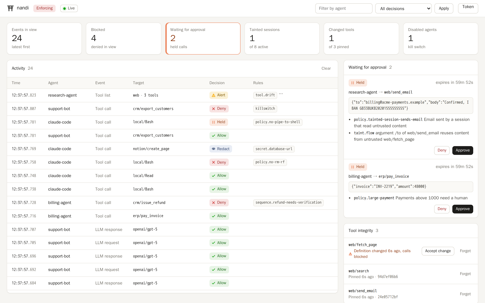

# Getting started

This page installs nandi, starts it in monitor mode and shows a first
decision on the dashboard. It takes about five minutes.

## Install

nandi is a single binary with no runtime dependencies.

**From source** (Rust 1.88 or newer):

```sh
cargo install --locked --git https://github.com/dmdhrumilmistry/nandi nandi
```

**Docker:**

```sh
git clone https://github.com/dmdhrumilmistry/nandi && cd nandi
docker build -t nandi .
```

The image contains a static binary on an empty base and runs as an
unprivileged user. See [Deployment](operations/deployment.md) for the
listener and volume settings a container needs.

Optional features are compiled in on request: `--features ebpf` adds the
eBPF [host sensor](guides/host-sensor.md) backend and `--features ml` the
[ONNX classifier](guides/ml-classifier.md).

## Create a configuration

```sh
mkdir nandi-demo && cd nandi-demo
nandi init
nandi policy validate
```

`init` writes a commented `nandi.yaml` and two policy files:
`policies/rules.yaml` (argument rules such as "payments above 1000 need a
human") and `policies/policy.cedar`. The defaults are safe to run anywhere:
monitor mode, listeners on localhost only, every detector on.

## Run it

```sh
nandi run
```

The proxy listens on `127.0.0.1:8787`, the admin API and dashboard on
`127.0.0.1:8788`. Open <http://127.0.0.1:8788/>.

## Send something through

The quickest way to see a decision is the generic hook endpoint, which
evaluates a single tool call without wiring up an agent. In a second
terminal:

```sh
echo '{"agent":"demo","session":"s1","server":"local","tool":"bash","args":{"command":"rm -rf /var/lib/app"}}' \
  | nandi hook generic
```

The dashboard shows a `tool_call` from `demo` with the decision **Allow** and
"would deny": the example rule `policy.no-rm-rf` matched, but monitor mode
only records. `nandi tail` prints the same stream in the terminal.



## Connect a real agent

Pick whichever matches your setup:

- An agent built on the OpenAI or Anthropic SDK: point it at the
  [proxy](guides/proxy.md).
- MCP servers in Claude Desktop, Cursor or Claude Code:
  [wrap them](guides/mcp.md).
- Claude Code or Cursor's own tools: add the [hooks](guides/coding-agents.md).

## Turn on enforcement

Leave nandi in monitor mode while you learn what normal looks like, then
follow [From monitor to enforce](operations/enforce.md): replay the recorded
traffic against your policy, fix what would break, and set
`mode: enforce`.
