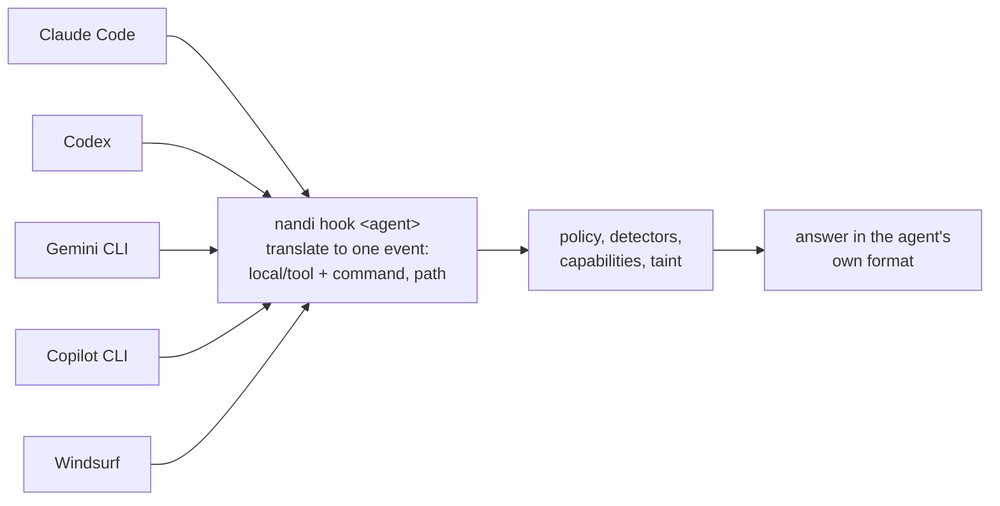

# Coding agents

Hooks let nandi see and gate the built-in tools of coding agents (shell,
file edits, web fetches), not just MCP. `nandi hook <agent>` reads the hook
payload on stdin, asks the running nandi (`POST /v1/hook/<agent>` on the
admin API) and prints the answer in that agent's format. If nandi is
unreachable the action is blocked, unless `--fail-open` is given.

| Agent | `nandi hook` | Blocks | Asks the user | Rewrites input | Admin-enforced hooks |
|---|---|---|---|---|---|
| Claude Code | `claude-code` | yes | yes | yes | managed settings |
| OpenAI Codex CLI | `codex` | yes | held in nandi's approval queue | yes | `requirements.toml`, macOS MDM |
| Gemini CLI | `gemini-cli` | yes | held in nandi's approval queue | yes | system `settings.json` |
| GitHub Copilot CLI | `copilot-cli` | yes | yes | blocks instead | `policy.d` |
| Cursor | `cursor` | yes | yes | blocks instead | |
| Windsurf (Cascade) | `windsurf` | yes (exit 2) | held in nandi's approval queue | blocks instead | system `hooks.json` |
| Devin CLI and Devin Local | `devin` | yes | held in nandi's approval queue | yes | |

`nandi hook-config <agent>` prints the configuration for an agent and where
it goes; `--write` installs it (merging into an existing JSON settings file
and keeping a backup), and `--managed` gives the system-wide, admin-enforced
variant for [fleets](../operations/mdm.md). `nandi hook-config all` covers
every agent.

```sh
nandi hook-config codex                    # print it
nandi hook-config all --write              # install for this user, every agent
sudo nandi hook-config all --managed --write   # enforced for every user (where supported)
```

The admin URL defaults to `admin.listen` from the config (or
`http://127.0.0.1:8788`); override it with `--admin`. The token comes from
`--token`, `NANDI_ADMIN_TOKEN` or `admin.token` in the config; give agent
machines a user with the `hook` role (see
[Users](../operations/users.md)).

## One policy for every agent

Every agent names its tools differently: a shell command is `Bash` in Claude
Code and Codex, `run_shell_command` in Gemini CLI, `bash` in Copilot CLI,
`exec` in Devin and `pre_run_command` in Windsurf. Policies should not have
to know. nandi gives you two things that are the same for every agent:

- **Capabilities.** Each tool is classified by what it can do
  (`command_execution`, `file_write`, `network_fetch`, ...), including every
  agent's built-in tools. See [capabilities](../policy/capabilities.md).
- **Shared argument names.** Next to the agent's own arguments, the event
  carries `command` for shell commands, `path` for files and `paths` for
  every file a patch touches (Codex `apply_patch`), whatever the agent
  called them (`command_line`, `file_path`, `filePath`, ...). The added
  names are removed from anything nandi sends back to the agent.

So one rule covers all of them:

```yaml
rules:
  - id: no-pipe-to-shell
    match:
      capability: command_execution
      args: { command: { regex: 'curl[^|]*\|\s*(ba)?sh' } }
    action: deny
  - id: no-env-writes
    match:
      args: { path: { glob: '*.env' } }
    action: deny
```

The [`coding-agent` policy pack](../policy/packs.md) is written this way.
Rules can still name an agent's own tools, or target one agent with
`agent:` (each format has its own default agent id: `codex`, `gemini-cli`,
`copilot-cli`, ...).



### Standards

There is no single standard for agent tool-call hooks yet. Claude Code's
hook format is the closest thing to one: Codex uses nearly the same events
and answers, Devin and Copilot CLI read Claude Code's settings files, and
Cursor imports them. The OWASP **Agent Control Standard** (ACS) defines a
proper wire protocol between agents and a policy "guardian", but it is a
pre-1.0 draft and no coding agent speaks it natively yet; nandi will follow
it once agents do. Until then, the adapters above translate each agent's
hooks into nandi's event model, and MCP traffic is covered for every agent
by [`nandi wrap`](mcp.md) and the [proxy](proxy.md), and model traffic by
the LLM proxy.

## Claude Code

In `~/.claude/settings.json` (all projects) or `.claude/settings.json`:

```json
{
  "hooks": {
    "PreToolUse": [
      { "matcher": "*", "hooks": [{ "type": "command", "command": "nandi hook claude-code -c /path/nandi.yaml" }] }
    ],
    "PostToolUse": [
      { "matcher": "*", "hooks": [{ "type": "command", "command": "nandi hook claude-code -c /path/nandi.yaml" }] }
    ],
    "UserPromptSubmit": [
      { "hooks": [{ "type": "command", "command": "nandi hook claude-code -c /path/nandi.yaml" }] }
    ]
  }
}
```

`PreToolUse` gates tool calls, `PostToolUse` feeds tool output into taint
tracking and detection, and `UserPromptSubmit` scans prompts.

How verdicts map to Claude Code:

- **allow**: no output, so Claude Code's own permission rules still apply
  (nandi never silently approves something your settings would ask about).
- **deny**: `permissionDecision: "deny"` with nandi's reason, which the
  model sees and can adapt to.
- **ask**: `permissionDecision: "ask"`, handing the decision to Claude Code's
  own prompt instead of nandi's approval queue.
- **redact**: the call proceeds with `updatedInput` carrying the redacted
  arguments.
- Findings in tool output (for example an injection in a fetched page) are
  returned as `additionalContext` warning the model that the content is
  untrusted data; a deny verdict blocks with `decision: "block"`.
- Prompts are blocked when they would leak a secret, since prompts cannot be
  rewritten.

MCP tools appear in Claude Code as `mcp__<server>__<tool>` and are mapped to
`<server>/<tool>` for policies; built-in tools (Bash, Read, Edit, WebFetch,
...) use the server name `local`, e.g. `local/Bash`.

## Cursor

In `~/.cursor/hooks.json` or `<project>/.cursor/hooks.json`:

```json
{
  "version": 1,
  "hooks": {
    "beforeShellExecution": [{ "command": "nandi hook cursor -c /path/nandi.yaml" }],
    "beforeMCPExecution": [{ "command": "nandi hook cursor -c /path/nandi.yaml" }],
    "beforeReadFile": [{ "command": "nandi hook cursor -c /path/nandi.yaml" }],
    "beforeSubmitPrompt": [{ "command": "nandi hook cursor -c /path/nandi.yaml" }],
    "afterShellExecution": [{ "command": "nandi hook cursor -c /path/nandi.yaml" }],
    "afterMCPExecution": [{ "command": "nandi hook cursor -c /path/nandi.yaml" }],
    "afterFileEdit": [{ "command": "nandi hook cursor -c /path/nandi.yaml" }]
  }
}
```

Shell commands map to `local/shell` (`{"command": ...}`), MCP calls to
`<server>/<tool>` and file reads to `local/read_file`. Cursor receives
`{"permission": "allow" | "deny" | "ask", "user_message", "agent_message"}`;
`after*` events are recorded and feed taint tracking. Cursor treats missing
output on permission hooks as a block, so nandi always answers explicitly.

Any other agent that can run a command before a tool call can use
`nandi hook generic` with `{"agent", "session", "server", "tool", "args"}` (or
`{"event": <nandi event>}`) on stdin. It prints
`{"verdict", "reason", "decision"}` and exits 0 when allowed, 2 when denied.

## OpenAI Codex CLI

`nandi hook-config codex` writes `~/.codex/hooks.json` (needs Codex 0.131 or
later; Codex asks you to trust new hooks once, in `/hooks`):

```json
{
  "hooks": {
    "PreToolUse": [{ "matcher": "*", "hooks": [{ "type": "command", "command": "nandi hook codex", "timeout": 600 }] }],
    "PostToolUse": [{ "matcher": "*", "hooks": [{ "type": "command", "command": "nandi hook codex", "timeout": 600 }] }],
    "UserPromptSubmit": [{ "hooks": [{ "type": "command", "command": "nandi hook codex", "timeout": 600 }] }]
  }
}
```

- Shell commands arrive as `Bash`, patches as `apply_patch` (with the
  patched files as `paths`), MCP tools as `mcp__<server>__<tool>`.
- Codex has no "ask" answer for hooks (it would run the tool), so calls
  nandi would ask about wait in nandi's approval queue (dashboard, CLI or
  webhook) and are then allowed or denied. The 600-second timeout leaves
  time for that.
- A tool's output cannot be replaced, so output nandi blocks or would
  redact is withheld with a reason.
- Codex runs a hook that fails or times out as if it allowed the call;
  `nandi hook` therefore denies by itself when nandi is unreachable.
- For fleets, `nandi hook-config codex --managed` gives the
  `requirements.toml` that enforces the hooks for every user (`/etc/codex`,
  `%ProgramData%\OpenAI\Codex`, or the macOS MDM key
  `requirements_toml_base64` of domain `com.openai.codex`).

## Gemini CLI

`nandi hook-config gemini-cli` adds `BeforeTool`, `AfterTool` and
`BeforeAgent` hooks to `~/.gemini/settings.json` (timeouts are in
milliseconds there). Shell commands are `run_shell_command`, MCP tools
carry their server in `mcp_context`. Calls nandi would ask about wait in its
approval queue. With `--managed` the hooks go into the system settings
file; note that Gemini CLI lets users disable a hook by name and skips
settings hooks in folders it does not trust, so check the
[footprint reports](discovery.md) on fleets.

## GitHub Copilot CLI

`nandi hook-config copilot-cli` writes `~/.copilot/hooks/nandi.json`, and
`--managed` a policy file in `/etc/github-copilot/policy.d` (or
`%ProgramData%\GitHub\Copilot\policy.d`) that users cannot disable.
`ask` is passed to Copilot's own confirmation. nandi never answers "allow",
because an explicit allow would skip Copilot's own approval; with no
objection it prints nothing. Copilot ignores what prompt hooks answer, so
prompts are recorded but cannot be blocked, and MCP tools
(`<server>-<tool>`) are matched against the servers nandi knows.

## Windsurf and Devin

`nandi hook-config windsurf` writes Cascade's `hooks.json` (user, or with
`--managed` the system file). Windsurf hooks can only block (exit code 2):
calls nandi would ask about wait in its approval queue, and an input nandi
would redact is blocked. `nandi hook-config devin` writes
`.devin/hooks.v1.json` for Devin CLI and Devin Local, which also read
Claude Code's settings.

## Behaviour when nandi is down

A hook that cannot reach nandi blocks the action, with the reason "nandi is
unavailable", in each agent's own format. This matters: Codex, Gemini CLI,
Windsurf and Devin let a tool run when its hook fails or times out, so the
blocking has to come from `nandi hook` itself. Add `--fail-open` to the hook
command to let actions through instead, for example on a laptop where nandi
is not always running.
