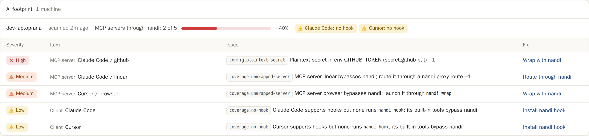

# AI footprint and coverage

nandi only protects what goes through it. `nandi discover` answers the
question that comes first: which AI agents, MCP servers, hooks, skills and
plugins are installed on this machine, and which of them bypass nandi?

```sh
nandi discover              # summary, findings and coverage
nandi discover --suggest    # plus the exact config changes that close the gaps
nandi discover --json       # the full inventory as JSON
nandi discover --report     # send it to the dashboard (admin API)
```

The scan reads configuration files only. It does not start any agent or
server, does not touch the network (except `--report`), and never fails:
missing files are skipped and files that cannot be parsed are listed as
warnings on stderr. The exit code is always 0, so it is safe in login
scripts and device management jobs.

By default it reads the user's home directory and the current directory as
a project. Use `--home DIR` and `--project DIR` (repeatable) to scan other
locations, for example every checkout under `~/src`.

```text
$ nandi discover
AI footprint of dev-laptop (nandi 0.1.0)

Clients
  Claude Code  1 of 3 servers via nandi  nandi hook: no  ~/.claude, ~/.claude.json
  Cursor       0 of 1 server via nandi   nandi hook: no  ~/.cursor, ~/.cursor/mcp.json

MCP servers
  Claude Code  user  github  stdio  BYPASS   npx -y @modelcontextprotocol/server-github
  Claude Code  user  fs      stdio  wrapped  npx server-fs
  Claude Code  user  lin     sse    BYPASS   http://mcp.corp.example/sse
  Cursor       user  b       stdio  BYPASS   npx @browsermcp/mcp

Findings (8)
  HIGH    config.plaintext-secret    Claude Code / github  Plaintext secret in env GITHUB_TOKEN (secret.github-pat) [ghp_***(40 chars)]
  ...

Coverage
  MCP servers through nandi: 1 of 4 (1 wrapped, 0 routed)
  Clients with the nandi hook: 0 of 2
  5 configuration changes would close the gaps: run `nandi discover --suggest`
```

## What is scanned

| Client | Files |
| --- | --- |
| Claude Code | `~/.claude.json` (`mcpServers`, and `projects.<path>.mcpServers`), `~/.claude/settings.json`, `<project>/.claude/settings.json` and `settings.local.json` (`hooks`, `env`), `<project>/.mcp.json`, skills in `~/.claude/skills/*/SKILL.md` and `<project>/.claude/skills/*/SKILL.md`, plugins under `~/.claude/plugins` (with their skills, `.mcp.json` and `hooks/hooks.json`) |
| Claude Desktop | `claude_desktop_config.json` in `~/Library/Application Support/Claude`, `~/.config/Claude` or `~/AppData/Roaming/Claude` |
| Cursor | `~/.cursor/mcp.json`, `<project>/.cursor/mcp.json`, `~/.cursor/hooks.json`, `<project>/.cursor/hooks.json`, extensions in `~/.cursor/extensions` |
| Windsurf | `~/.codeium/windsurf/mcp_config.json` |
| VS Code | user `settings.json` (`mcp.servers`) and `mcp.json` in `~/.config/Code/User` or `~/Library/Application Support/Code/User`, `<project>/.vscode/mcp.json`, extensions in `~/.vscode/extensions` |
| Codex | `~/.codex/config.toml` (`[mcp_servers.<name>]`) |
| Gemini CLI | `~/.gemini/settings.json`, `<project>/.gemini/settings.json` (`mcpServers`) |
| Zed | `~/.config/zed/settings.json` (`context_servers`) |
| Continue | `~/.continue/config.json`, `~/.continue/config.yaml`, `~/.continue/mcpServers/*.yaml` |

Settings files with comments and trailing commas (VS Code, Zed) are
accepted. Editor extensions are listed with their version; known AI
assistants (Copilot, Continue, Cline, Roo Code, Codeium, Amazon Q, Cody,
Tabnine and anything published by Anthropic or OpenAI) are flagged as AI
related.

An MCP server counts as **through nandi** when it is either:

- **wrapped**: its command is `nandi` (or a path ending in `/nandi`) with
  `wrap` in the arguments. The inventory records the `--server` name, the
  `-c` config and the real server command after `--`.
- **routed**: its URL starts with a nandi proxy base URL. The defaults are
  `http://127.0.0.1:8787` and `http://localhost:8787`, plus `listen.proxy`
  from the config; `--proxy-url URL` (repeatable) replaces the defaults, for
  example with a shared gateway's address.

Servers marked `"disabled": true` (or `enabled = false`) are listed but not
counted.

## Findings

| Rule | Severity | Raised for |
| --- | --- | --- |
| `config.plaintext-secret` | high | a secret written into an MCP server's `env`, `headers`, arguments or URL, or into Claude Code's `env` settings. Detected with nandi's [secret scanners](../policy/detection.md), including key-name heuristics such as `--password <value>` |
| `coverage.unwrapped-server` | medium | an enabled MCP server that is neither wrapped nor routed |
| `coverage.no-hook` | low | Claude Code or Cursor with no hook running `nandi hook`, so their built-in tools (shell, edits, fetches) bypass nandi |
| `server.remote-http` | low | a remote MCP server over plain `http://` to a host that is not loopback |
| `skill.pipe-to-shell` | high | a skill that downloads a script into a shell (`curl ... \| sh`, `bash <(curl ...)`, `iwr ... \| iex`) |
| `skill.base64-shell` | high | `base64 -d ... \| sh` |
| `skill.credential-access` | high | reads of `~/.ssh`, `id_rsa`, `.aws/credentials`, `.netrc`, `.git-credentials`, `.env` or the keychain (`security find-generic-password`) |
| `skill.disable-safety` | medium | `--dangerously-skip-permissions`, `bypassPermissions`, `--dangerously-bypass-approvals-and-sandbox`, `--yolo` |
| `hook.*` | as above | the same command checks applied to hook commands |

Every text file in a skill directory (up to 200 files, each up to 256 KiB;
binaries, symlinks and hidden or dependency folders are skipped) is also run
through the detector's ingress scan (prompt injection, hidden unicode,
exfiltration links) and its secret scan, so those findings appear with their
usual rule ids, such as `injection.ignore-instructions`.

## Closing the gaps

`--suggest` prints, for every gap, the file to edit and a snippet in that
file's format:

- an unwrapped stdio server gets its `nandi wrap` replacement. The original
  command and arguments move after `--`; keep the server's `env` as it is:

  ```json
  { "github": { "command": "nandi", "args": ["wrap", "-c", "/etc/nandi/nandi.yaml", "--server", "github", "--", "npx", "-y", "@modelcontextprotocol/server-github"] } }
  ```

- an unrouted remote server gets an `mcp` route for `nandi.yaml` and the
  proxy URL to put in the client (see [Proxy](proxy.md#remote-mcp-servers)).
  Move headers carrying credentials into the route's `inject_headers`.
- Claude Code or Cursor without the hook gets the settings block from
  [Coding agents](coding-agents.md).

The config path in the snippets is `--config` made absolute; set another
with `--nandi-config PATH`. Codex snippets are TOML. The suggestions are
also in the JSON inventory under `coverage.suggestions`.

## The dashboard

`nandi discover --report` posts the inventory to the admin API
(`POST /v1/inventory`, see [Admin API](../reference/admin-api.md)). The
admin URL and token come from `--admin` and `--token` (or
`NANDI_ADMIN_TOKEN`), else from the config, like every other admin command.
A failed report is printed as a warning and still exits 0.

The dashboard's **AI footprint** card shows every reporting machine, newest
scan first: when it was scanned, how many MCP servers go through nandi,
which clients have the nandi hook, and a table of the items that need
attention (unwrapped servers, plaintext secrets, risky skills and hooks)
ordered by severity. Click a row for the findings and the suggested fix.



## Running it on a schedule or from MDM

Run it as the user whose agents you want to see (it reads that user's
home directory). With cron:

```cron
17 * * * * NANDI_ADMIN_TOKEN=... /usr/local/bin/nandi discover --report --admin https://nandi.internal:8788 >/dev/null
```

From a device management tool (Jamf, Intune, Kandji, Fleet), deploy the
`nandi` binary and run the same command in a per-user script. Each report
replaces the host's previous one; the host name comes from the operating
system (override with `NANDI_HOST`). The admin API must be reachable from
the machines, so use `admin.token` and bind `admin.listen` on an internal
interface.

## Privacy

The inventory contains client names, configuration file paths, MCP server
names, commands, arguments and URLs, environment variable and header
**names**, hook commands, skill, plugin and extension names and versions,
and the host name. It never contains environment variable or header
values: secrets found anywhere are reported only as masked evidence (for
example `ghp_***(40 chars)`), and arguments, URLs and hook commands are
stored with secrets replaced by `[REDACTED:<rule>]`. Skill file contents are
scanned locally and never sent; only findings with a short, redacted
excerpt are. Review `nandi discover --json` before enabling `--report` if
command lines in your organization are themselves sensitive.

## Limitations

- Only the files listed above are read. Managed or system-wide settings
  (for example Claude Code's `managed-settings.json`) and per-workspace
  settings of editors other than those listed are not scanned.
- MCP servers added at runtime, through an extension's own UI or by a
  plugin that generates its configuration are not seen.
- A server launched through a shell wrapper script that calls `nandi wrap`
  is reported as bypassing nandi, because the script is not inspected.
- Skill checks are pattern based: they flag well-known dangerous commands
  and can be evaded by obfuscation. Treat a clean skill as "nothing obvious",
  not as reviewed.
