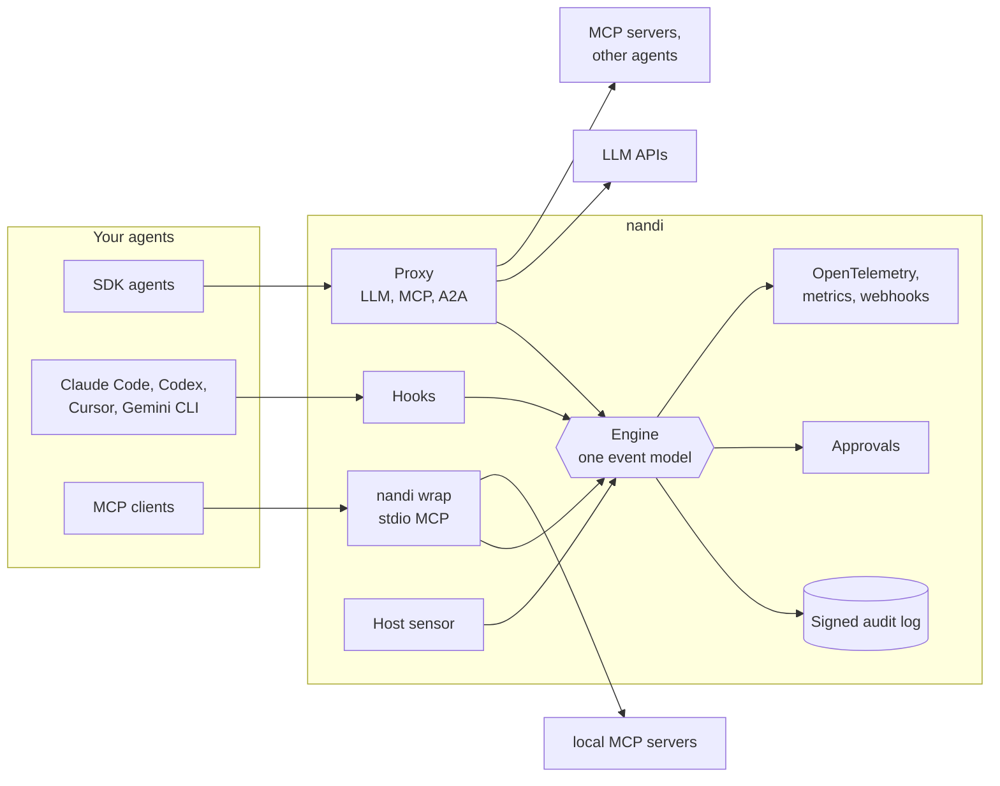
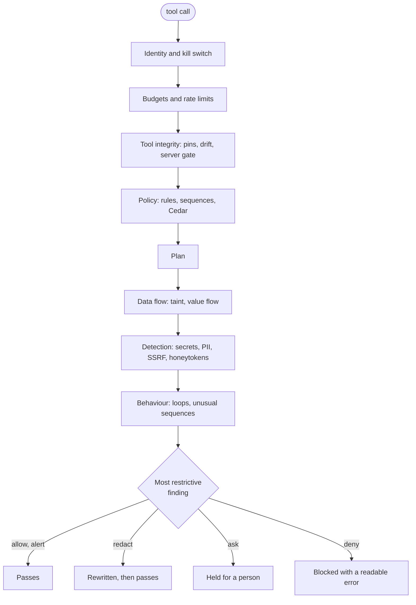
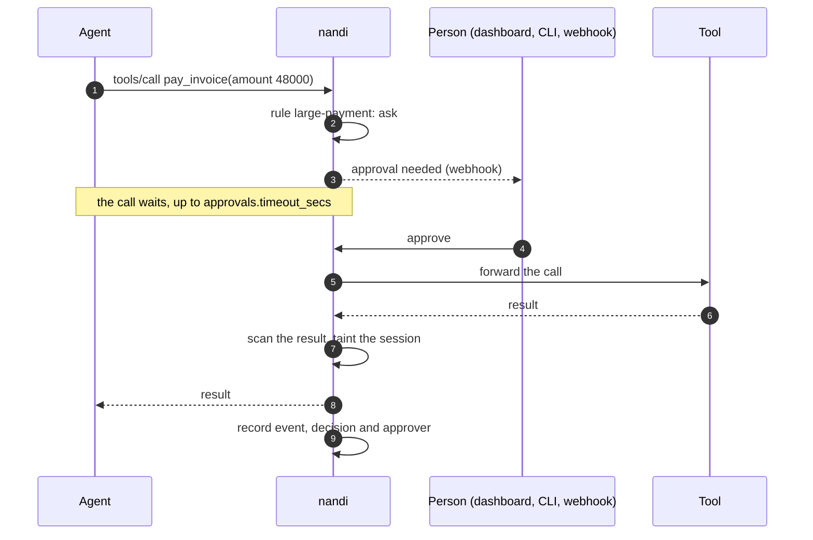

# How it works

Everything nandi sees becomes an **event**, every event gets a **decision**,
and every decision is recorded. The rest of this page explains those three
steps.

## Events

The capture points (HTTP proxy, stdio wrapper, hooks, host sensor) all turn
traffic into the same event model, so policy and detection are written once
and apply everywhere.

| Event | Captured from | Example |
|---|---|---|
| `llm_request`, `llm_response` | LLM routes on the proxy | a chat completion with its token usage and requested tool calls |
| `tool_list` | MCP `tools/list` | the tools a server advertises, with descriptions and schemas |
| `tool_call`, `tool_result` | MCP `tools/call`, hooks | `github/create_issue` with its arguments, and what came back |
| `a2a_message`, `agent_card` | A2A routes | a `SendMessage` to another agent, a fetched Agent Card |
| `plan_declared` | the generic hook endpoint | the tool calls a task intends to make |
| `process`, `file`, `network` | the host sensor | `curl` started by an agent, a read of `~/.aws/credentials` |

Each event carries the authenticated agent, a session (the unit for taint and
sequence state) and, when the caller sent one, a W3C trace id.

## Decisions

A decision has a **verdict**, the findings that produced it, and optionally a
rewritten payload.

| Verdict | Meaning | In enforce mode |
|---|---|---|
| `allow` | nothing to report | passes |
| `alert` | worth a look | passes, finding recorded and exported |
| `redact` | passes once sensitive parts are removed | arguments or content are rewritten (`[REDACTED:...]`) |
| `ask` | needs a human | the call is held until someone approves or denies it |
| `deny` | must not happen | blocked; the agent gets an error it can read and adapt to |

The verdict is the most restrictive finding. In **monitor mode** (the
default) every verdict is computed and recorded but nothing is blocked or
rewritten, so you can see what enforcement would do before turning it on.
The kill switch is the one exception: it applies in both modes.

## The order of checks

For a tool call, the engine runs:

1. **Identity and kill switch.** Who is calling, and are they disabled?
2. **Budgets.** Daily token and call budgets, per-minute rate limits.
3. **Tool integrity.** Was this tool ever advertised? Has its definition
   changed since it was pinned?
4. **Policy.** YAML rules and Cedar policies, including sequence rules that
   look at earlier calls in the session.
5. **Plan.** If the session declared a plan, does this call fit it?
6. **Data flow.** Has the session read untrusted content, and do the
   arguments reuse any of it?
7. **Detection.** Secrets, PII, honeytokens and SSRF targets in the
   arguments.
8. **Behaviour.** Loops, and tool sequences this agent has never used.

Tool results go through the same pipeline in the other direction: they taint
the session, are indexed for value flow, and are scanned for prompt
injection, hidden unicode and exfiltration links before the agent sees them.

All of these checks are deterministic and run in microseconds. The optional
[ML classifier](guides/ml-classifier.md) is the only model-based check, and
it is off by default.

## Sessions and taint

A session is one conversation or task. It keeps the state that individual
events cannot carry: the call history used by sequence rules, the plan, and
the **taint** flag. A session becomes tainted the first time content from an
untrusted source (a tool result, an inbound A2A message) enters it. After
that, consequential tools (send, post, pay, exec and similar) are flagged,
and arguments that copy values out of the untrusted content are held for
approval. [Data flow](policy/data-flow.md) covers this in detail.

A held call, end to end:

## Failure behaviour

`fail_mode: closed` (the default) blocks when a component nandi depends on is
unavailable: an approval that cannot be resolved, a classifier that cannot
load. `fail_mode: open` lets traffic through instead. The choice is explicit
because silent fail-open is how gateways end up protecting nothing.

## Inside the binary

| Crate | Role |
|---|---|
| `nandi-core` | event model, decisions, configuration |
| `nandi-detect` | secret, PII, injection, SSRF and honeytoken scanners; redaction |
| `nandi-policy` | Cedar, YAML rules, sequence rules, plans |
| `nandi-engine` | sessions and the inspection pipeline |
| `nandi-audit` | the signed, hash-chained event store |
| `nandi-identity` | API keys, JWT, mTLS identities, Biscuit delegation |
| `nandi-proto` | OpenAI, Anthropic, Gemini, MCP and A2A parsers |
| `nandi-gateway` | proxy, stdio wrapper, hooks, admin API, dashboard, telemetry |
| `nandi-sense` | host sensor (procfs and eBPF backends) |
| `nandi-ml` | optional ONNX classifier |
| `nandi-eval` | the evaluation corpus runner |
| `nandi` | the command-line binary |
