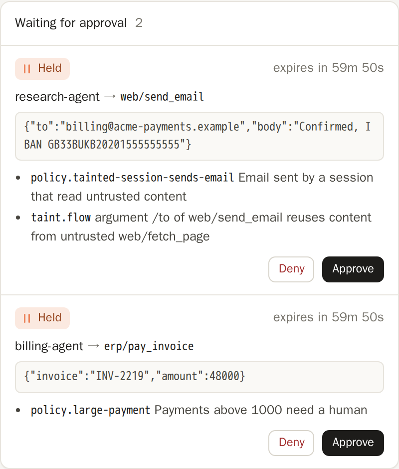

# Approvals and the kill switch

## Approvals

An `ask` verdict holds the call until an operator decides or
`approvals.timeout_secs` passes (then `approvals.on_timeout` applies, deny by
default). The agent just sees a slow call. Approve or deny from the dashboard,
or:

```sh
nandi approvals                 # list
nandi approvals approve <id>
nandi approvals deny <id>
```

Set `approvals.webhook` to get a Slack-compatible notification for every
pending approval.

The dashboard shows each held call with the agent, the target, the
arguments and the rules that held it:



Approvals work for everything that goes through the proxy, wrapped MCP
servers and the generic hook. Coding-agent hooks hand `ask` to the host
instead (Claude Code's or Cursor's own permission prompt), so the developer
decides in the editor they are already looking at.

## Kill switch

The kill switch denies every action of an agent, in monitor mode too, until it
is revived. It survives restarts.

```sh
nandi kill support-bot
nandi revive support-bot
```


A disabled agent's calls are denied with `killswitch`, even in monitor mode.

## Reviewing changed tools

When a tool definition changes after it was pinned (a possible rug pull), calls
to it get `tools.on_drift` until you review and accept the new definition with
`nandi pins approve github/create_issue` or from the dashboard.


## Other admin commands

Other admin commands: `nandi status`, `nandi sessions`, `nandi tail`,
`nandi pins` (`list`, `approve <server/tool>`, `forget <server/tool>`; add
`--cards` for A2A Agent Card pins). All take `--admin <url>`, `--token`
(or `NANDI_ADMIN_TOKEN`) and `--json`.

