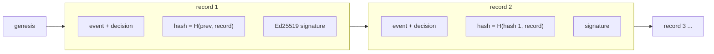

# Audit log

Every evaluated event and its decision is appended to a hash-chained,
Ed25519-signed log in `<data_dir>/audit.redb` (key in
`<data_dir>/audit.key`, created on first start).

```sh
nandi audit head                       # newest seq, hash and the public key
nandi audit verify                     # recompute the chain, check every signature
nandi audit export --out audit.jsonl   # JSON lines for archival or an auditor
nandi audit verify --export audit.jsonl --pubkey <hex public key>
```

An auditor needs only the export and the public key. Publishing `audit head`
somewhere else (a ticket, a chat channel) lets them also detect truncation.
While nandi is running, `GET /v1/audit/verify` on the admin API verifies the
live log.




Changing, removing or reordering any record breaks every hash after it, and
the signatures tie the chain to this log's key. Administrative actions
(approvals, the kill switch, policy and user changes) are records in the same
chain.

## What a record contains

Each record holds the event, the decision (verdict, findings, whether it was
enforced), the previous record's hash, its own hash and an Ed25519 signature
over that hash. Changing any field of any record breaks the chain at that
point, and records cannot be inserted, reordered or removed from the middle
without the private key.

## Retention

`audit.retention_days` (30 by default, 0 keeps everything) drops the oldest
records. Pruning keeps a signed anchor, so verification still works on what
remains. Set `audit.record_clean: false` to store only events with findings
when volume matters more than a complete trail.
