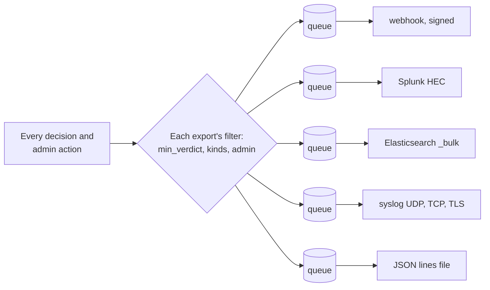
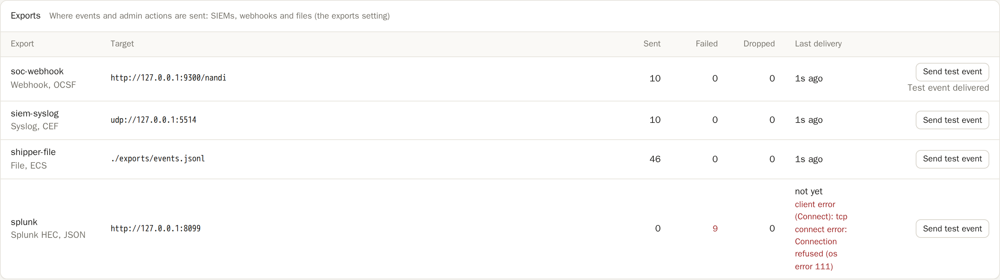

# SIEM and webhook exports

nandi can send every decision and every administrative action to the tools
your security team already uses: a SIEM (Splunk, Elastic, Sentinel, QRadar,
ArcSight), a webhook (SOAR, chat, your own service), or a file that a log
shipper picks up. Each destination is an entry under `exports`.

```yaml
exports:
  - name: splunk
    type: splunk_hec
    url: https://splunk.corp.example:8088
    token: env:SPLUNK_HEC_TOKEN
    index: security
    format: ocsf
  - name: soc
    type: syslog
    address: tls://siem.corp.example:6514
    ca_file: /etc/nandi/siem-ca.pem
    format: cef
  - name: soar
    type: webhook
    url: https://soar.corp.example/hooks/nandi
    secret: env:NANDI_WEBHOOK_SECRET
```



## What is sent

- **Decisions** at or above `min_verdict` (default `alert`: alerts,
  redactions, holds and denials). Set `min_verdict: allow` to send
  everything, and `kinds` to limit event kinds (`tool_call`, `llm_request`,
  `a2a_message`, ...).
- **Administrative actions** (approvals, the kill switch, pin and policy
  changes, user changes, refused requests; see the
  [audit trail](users.md#the-audit-trail)), unless `admin: false`.

Each event carries who (the agent, or the person for admin actions), what
(the tool, model or peer), the decision and the rules that fired, the
session, and its audit sequence number.

## Destinations

| `type` | Settings | Notes |
|---|---|---|
| `webhook` | `url`, `secret`, `headers`, `batch` | One JSON POST per event, or with `batch: true` one JSON array per batch |
| `splunk_hec` | `url`, `token`, `index` | HTTP Event Collector, `sourcetype` `nandi:<format>` |
| `elastic` | `url`, `api_key`, `index` (default `nandi-events`) | `_bulk` with `create`, so data streams work too; also OpenSearch |
| `syslog` | `address` (`udp://`, `tcp://` or `tls://host:port`), `facility`, `ca_file` | RFC 5424; TCP is newline framed, TLS uses octet counting (RFC 5425) |
| `file` | `path`, `max_file_mb` (default 100) | JSON lines; rotates to `.1` ... `.5` |

Common settings: `format`, `min_verdict`, `kinds`, `admin`, `max_batch`
(default 100) and `flush_ms` (default 1000). Secrets and header values take
`env:` and `file:` like the rest of the configuration.

## Formats

| `format` | Default for | What it is |
|---|---|---|
| `json` | webhook, Splunk, file | nandi's own: `{"schema": "nandi.event.v1", "type", "seq", "event", "decision", "applied"}` |
| `ocsf` | | [OCSF](https://schema.ocsf.io) 1.3: decisions with findings are Detection Finding (2004), other decisions and admin actions API Activity (6003); the full nandi event is under `unmapped.nandi` |
| `ecs` | Elastic | Elastic Common Schema: `@timestamp`, `event.*`, `user.name`, `rule.*`, with the nandi event under `nandi` |
| `cef` | syslog | ArcSight CEF: signature id is the first rule, severity 0 to 10, `suser`, `act`, `request`, `cs1` (rules), `cs2` (session) |

OCSF fields used: `time`, `severity_id` (finding severity, 1 to 5),
`disposition_id` (1 allowed, 2 blocked, 99 other with `disposition` held,
redacted or alerted), `actor.user.name`, `actor.session.uid`,
`api.operation` (event kind), `api.service.name` and `resources` (the
target), `finding_info` (rules and messages), and `metadata.product`.

## Recipes

**Splunk.** Create an HEC token, then use `type: splunk_hec` with the
collector URL. `format: ocsf` works with the Splunk OCSF add-on; `json`
keeps nandi's own fields.

**Elasticsearch or OpenSearch.** Create an API key with permission to write
the index, then `type: elastic`. ECS fields land in the standard places, so
Kibana's security views and detection rules can use them.

**Microsoft Sentinel.** Send CEF over syslog to a Linux log forwarder
running the Azure Monitor Agent with the "Common Event Format via AMA"
connector: `type: syslog`, `address: tcp://forwarder:514`, `format: cef`.

**IBM QRadar, ArcSight and other syslog SIEMs.** `type: syslog`,
`format: cef`, preferably over `tls://` with `ca_file` for a private CA.

**Datadog.** A webhook to the logs intake with the API key as a header:

```yaml
  - name: datadog
    type: webhook
    url: https://http-intake.logs.datadoghq.com/api/v2/logs
    headers: { DD-API-KEY: "env:DD_API_KEY" }
    batch: true
```

**SOAR and chat** (Tines, Torq, n8n, a Slack relay). A signed `webhook`;
the `X-Nandi-Event` header (`decision` or `admin`) helps routing.

**Log shippers** (Fluent Bit, Vector, Filebeat, the Azure Monitor Agent,
AWS Security Lake via a custom source). `type: file` in the format the
pipeline expects, and point the shipper at the file.

## Verifying webhook signatures

With `secret` set, every request carries
`X-Nandi-Signature: t=<unix seconds>,v1=<hex>`, where `v1` is the
HMAC-SHA256 of `<t>.<raw body>` with the secret. Reject requests whose
signature does not match or whose `t` is more than a few minutes old:

```python
import hashlib, hmac, time

def verify(secret: bytes, header: str, body: bytes, tolerance: int = 300) -> bool:
    parts = dict(p.split("=", 1) for p in header.split(","))
    t = int(parts["t"])
    if abs(time.time() - t) > tolerance:
        return False
    expected = hmac.new(secret, f"{t}.".encode() + body, hashlib.sha256).hexdigest()
    return hmac.compare_digest(expected, parts["v1"])
```

Requests also carry `X-Nandi-Delivery`, a unique id per request.

## Delivery

- Exports never slow agents down. Each export has a queue of 4,096 events;
  when it is full, new events for that export are dropped and counted.
- HTTP destinations get **at-least-once** delivery: a failed batch is tried
  three times (after 1 and 2 seconds). `408`, `429` and `5xx` are retried;
  other `4xx` (bad token, rejected documents) are not. Retries can repeat
  events: deduplicate on `event.id`.
- Syslog has no acknowledgements. UDP is best effort. Over TCP and TLS nandi
  checks for a closed connection before each write and reconnects, but a
  connection that breaks mid-write can still lose a batch. Use HTTP, or a
  file and a shipper, when every event must arrive.
- The signed [audit log](audit.md) stays the record of truth. To backfill a
  SIEM with history, export it in a SIEM format:

```sh
nandi audit export --format ocsf --out history.jsonl   # also json, ecs, cef
```

## Status and testing



The dashboard's **Audit** tab lists every export with events sent, failed and
dropped, the last delivery and the last error, and a **Send test event**
button for admins. The same is available on the
[admin API](../reference/admin-api.md) (`GET /v1/exports`,
`POST /v1/exports/{name}/test`) and in Prometheus:
`nandi_export_sent_total`, `nandi_export_failed_total`,
`nandi_export_dropped_total`, each labelled by `export`.

The older `telemetry.webhooks` setting (findings at or above
`telemetry.webhook_min_severity`, unsigned) still works; `exports` replaces
it.
