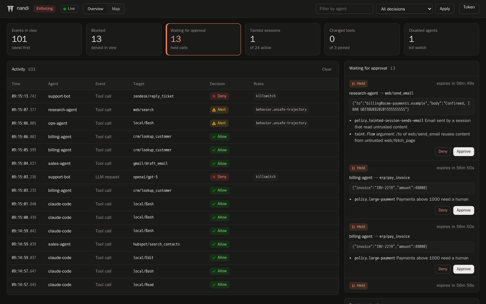
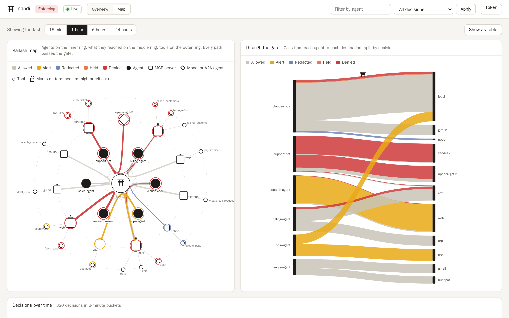

# Observability

## Dashboard

The admin listener serves a dashboard at `/`: the live event stream, calls
waiting for approval, tool integrity, the kill switch, sessions with their
taint and risk, and today's usage. Click an event to see its findings and
the raw event. It is a single page with no external assets, and it follows
the system's light or dark setting.



When `admin.token` is set the page asks for it (Token, top right) and keeps
it in the browser's local storage.

### Map

The Map tab (or `/#map`) draws the audit log for the last 15 minutes to 24
hours three ways:

- **Kailash map.** Agents on the inner ring, the MCP servers, models and
  peers they reached on the middle ring, and tools on the outer ring. Every
  path runs through the gate in the centre. Line width is call volume, and a
  coloured outline marks anything that was alerted, redacted, held or denied.
  Small marks on top of a server show its
  [risk](../policy/capabilities.md#risk-scores): one for medium, two for
  high, three for critical.
- **Through the gate.** A flow from each agent to each destination, split by
  decision, so you can see which agent drives which traffic and where the
  denials come from.
- **Decisions over time.** Stacked bars per time bucket.

Hover any mark for its counts, or use **Show as table** for the same data as
tables. The busiest 40 destinations and 80 tools are drawn; the rest fold
into "other". The map needs the audit log (`audit.enabled`); the data comes
from [`GET /v1/graph`](../reference/admin-api.md).



## Terminal

```sh
nandi tail                         # every event as it happens
nandi tail --min-verdict alert     # only what matters
nandi tail --agent billing-agent --json
```

```text
12:50:19.619  research-agent   tool_call    web/fetch_page                     deny         ssrf.metadata
12:50:19.685  billing-agent    tool_call    crm/issue_refund                   deny         sequence.refund-needs-verification
12:50:19.725  claude-code      tool_call    notion/create_page                 redact       secret.database-url
12:50:19.742  claude-code      tool_call    local/Bash                         ask          policy.no-pipe-to-shell
12:50:19.763  support-bot      tool_call    crm/export_customers               deny         killswitch
```

When the verdict and what was applied differ (monitor mode, or an operator's
decision), the column shows both, for example `deny>allow`.

## Metrics, tracing and webhooks

- Prometheus: `GET http://127.0.0.1:8788/metrics` (`telemetry.prometheus`,
  on by default): events by kind, decisions by verdict, enforced verdicts,
  evaluation latency, approvals, recorder drops, plus gauges for sessions,
  pending approvals and killed agents.
- OpenTelemetry: set `telemetry.otlp_endpoint` (for example
  `http://127.0.0.1:4318`) and optional `otlp_headers`; events are exported as
  OTLP/HTTP spans following the GenAI semantic conventions.
- Webhooks: `telemetry.webhooks` receive findings at or above
  `telemetry.webhook_min_severity`.
- Health: `GET /healthz` (no auth) returns status, version, mode and uptime.


Logs go to stderr; `telemetry.log_format: json` switches `nandi run` to JSON
lines.
