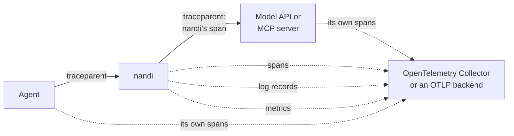
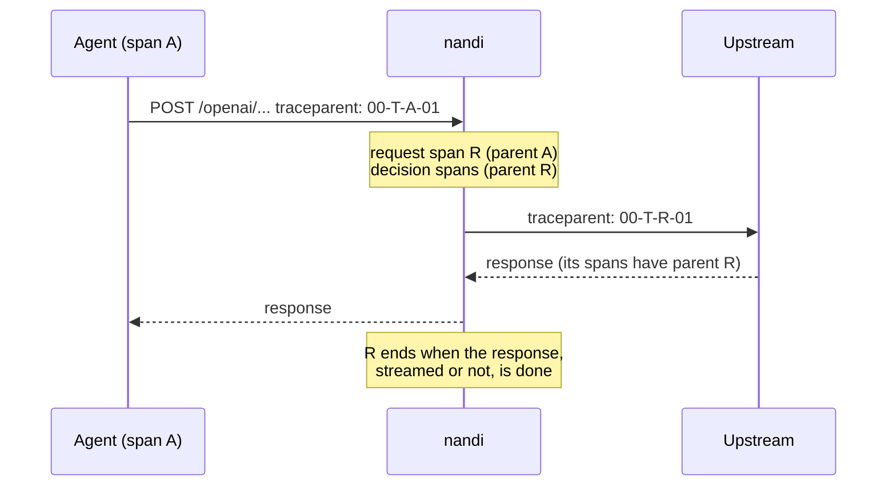

# OpenTelemetry

nandi exports all three OpenTelemetry signals over OTLP/HTTP, so its
decisions show up in the tracing, logging and metrics tools you already run:

- **Traces.** A span for every proxied request and for every decision,
  following the GenAI and MCP semantic conventions. nandi continues the
  agent's trace and passes its own span upstream, so one trace runs from the
  agent through nandi to the model or MCP server.
- **Logs.** A log record for every decision and every administrative action,
  linked to its span.
- **Metrics.** The same counters, gauges and latency histogram as the
  [Prometheus endpoint](observability.md#metrics-tracing-and-webhooks),
  pushed on an interval.

It works with the OpenTelemetry Collector and anything that accepts OTLP:
Grafana (Tempo, Loki, Mimir), Jaeger, Honeycomb, Datadog, New Relic,
Dynatrace, Elastic and others.

```yaml
telemetry:
  otlp_endpoint: http://otel-collector:4318
```

Or with the standard environment variables and no change to the
configuration file:

```sh
OTEL_EXPORTER_OTLP_ENDPOINT=http://otel-collector:4318 \
OTEL_SERVICE_NAME=nandi-gateway \
OTEL_RESOURCE_ATTRIBUTES=deployment.environment.name=prod \
nandi run
```



## Traces

When an agent sends a W3C `traceparent` header, nandi continues that trace.
Otherwise it starts one. Either way, it sends `traceparent` to the upstream
with its own span as the parent, so whatever the upstream records nests
under nandi:



The trace then looks like this:

```text
agent: invoke_agent research-agent                 (span A, the agent's)
└── nandi: POST /openai                            (span R, kind server)
    ├── nandi: chat gpt-4o                         decision on the request
    ├── openai: chat.completions                   (the upstream's own span, if it records one)
    └── nandi: chat gpt-4o response                decision on the response
```

| Span | Kind | When |
|---|---|---|
| `{method} {route prefix}`, for example `POST /openai` | server | every request through the proxy, from arrival until the response is done |
| `chat {model}`, `chat {model} response` | internal | LLM requests and responses |
| `execute_tool {tool}`, `tool_result {tool}`, `tools/list {server}` | internal | MCP tool calls, results and tool lists |
| `invoke_agent {peer}` | internal | A2A messages |
| `process`, `file`, `network` | internal | host sensor events |

Decision spans last as long as the evaluation (usually well under a
millisecond). A denied call has status `ERROR` with the reason as the
message; request spans are errors for `5xx` responses only.

Attributes on decision spans:

| Attribute | Value |
|---|---|
| `gen_ai.operation.name` | `chat`, `execute_tool`, `invoke_agent` |
| `gen_ai.provider.name`, `gen_ai.request.model` | LLM provider and model |
| `gen_ai.usage.input_tokens`, `gen_ai.usage.output_tokens` | token usage on responses |
| `gen_ai.tool.name`, `gen_ai.tool.call.id`, `mcp.server.name`, `mcp.method.name` | MCP tool calls |
| `gen_ai.agent.id`, `gen_ai.conversation.id` | the agent and the session |
| `nandi.verdict`, `nandi.applied`, `nandi.enforced` | the decision, what was applied (monitor mode, approvals), and whether it was enforced |
| `nandi.rules`, `nandi.severity`, `nandi.findings`, `nandi.risk` | the rules that fired, the highest severity, the number of findings, the risk score |
| `nandi.event.id`, `nandi.event.kind`, `nandi.audit.seq`, `nandi.source` | link to the [audit log](audit.md) and the capture point |

Request spans carry `http.request.method`, `http.route`, `url.path`,
`http.response.status_code`, `nandi.route` and `gen_ai.agent.id`.

The audit log keeps each event's `trace_id` and `parent_span_id`, and
[exports](exports.md) carry them too, so you can go from a SIEM alert to the
trace. A decision's span id is the last 16 hex digits of its event id.

Agent hooks and the stdio wrapper have no trace context from the agent; each
of their decisions is a trace of its own. Set
`telemetry.propagate_trace_context: false` to leave the caller's
`traceparent` untouched (decisions then hang directly under the caller's
span, and nandi records no request spans).

## Logs

| Event name | Severity | When |
|---|---|---|
| `nandi.decision` | `INFO` allowed, `WARN` alert, redaction or hold, `ERROR` denied | every decision at or above `otlp_logs_min_verdict` (default `allow`: all of them) |
| `nandi.admin` | `INFO`, or `WARN` when it was denied or failed | approvals, the kill switch, policy and user changes, refused requests ([audit trail](users.md#the-audit-trail)) |

The body is a one-line summary, for example
`billing-agent tool_call bank/transfer: deny (policy.large-payment: Payments above 1000 need a human)`.
Attributes are those of the span; admin records carry `user.name`,
`nandi.admin.action`, `nandi.admin.target`, `nandi.admin.outcome` and
`nandi.admin.details`. Decision records carry the trace and span id of their
span, so a tracing tool can show them on the span.

Set `otlp_logs_min_verdict: alert` to send only what was flagged.

## Metrics

Counters are cumulative sums since nandi started; the evaluation latency is
an explicit-bucket histogram in seconds.

| OpenTelemetry | Prometheus | Attributes |
|---|---|---|
| `nandi.events` | `nandi_events_total` | `kind` |
| `nandi.decisions` | `nandi_decisions_total` | `verdict` (before monitor mode) |
| `nandi.enforced` | `nandi_enforced_total` | `verdict` (applied) |
| `nandi.findings` | `nandi_findings_total` | `category` |
| `nandi.eval.duration` | `nandi_eval_duration_seconds` | |
| `nandi.llm.tokens` | `nandi_llm_tokens_total` | |
| `nandi.upstream.requests`, `nandi.upstream.errors` | `nandi_upstream_requests_total`, `nandi_upstream_errors_total` | |
| `nandi.auth.failures` | `nandi_auth_failures_total` | |
| `nandi.approvals.requested`, `.granted`, `.denied`, `.timed_out` | `nandi_approvals_*_total` | |
| `nandi.recorder.dropped`, `nandi.audit.errors` | `nandi_recorder_dropped_total`, `nandi_audit_errors_total` | |
| `nandi.export.sent`, `.failed`, `.dropped` | `nandi_export_*_total` | `export` |
| `nandi.otlp.sent`, `.failed`, `.dropped` | `nandi_otlp_*_total` | `signal` |
| `nandi.sessions`, `nandi.approvals.pending`, `nandi.agents.killed` | gauges of the same names with `_` | |

## Settings

Everything lives under `telemetry`. Each setting falls back to the standard
environment variable when it is not set in the file, so a collector sidecar
or the OpenTelemetry Operator can configure nandi like any other service.

| Setting | Environment variable | Default |
|---|---|---|
| `otlp_endpoint` (base URL; signals go to `/v1/traces`, `/v1/metrics`, `/v1/logs`) | `OTEL_EXPORTER_OTLP_ENDPOINT` | none: OTLP is off |
| `otlp_traces_endpoint`, `otlp_metrics_endpoint`, `otlp_logs_endpoint` (full URLs) | `OTEL_EXPORTER_OTLP_{TRACES,METRICS,LOGS}_ENDPOINT` | from the base URL |
| `otlp_headers` (values take `env:` and `file:`) | `OTEL_EXPORTER_OTLP_HEADERS`, `OTEL_EXPORTER_OTLP_{SIGNAL}_HEADERS` | none |
| `otlp_protocol`: `http/protobuf` or `http/json` | `OTEL_EXPORTER_OTLP_PROTOCOL` | `http/protobuf` |
| `otlp_compression`: `gzip` or `none` | `OTEL_EXPORTER_OTLP_COMPRESSION` | `none` |
| `otlp_signals: { traces, metrics, logs }` | `OTEL_{TRACES,METRICS,LOGS}_EXPORTER=none` turns one off | all on |
| `otlp_metrics_interval_secs` | `OTEL_METRIC_EXPORT_INTERVAL` (milliseconds) | 60 seconds |
| `otlp_logs_min_verdict` | | `allow` |
| `service_name` | `OTEL_SERVICE_NAME` | `nandi` |
| `resource_attributes` | `OTEL_RESOURCE_ATTRIBUTES` | |
| `propagate_trace_context` | | `true` |
| | `OTEL_EXPORTER_OTLP_TIMEOUT` (milliseconds) | 10 seconds |
| | `OTEL_SDK_DISABLED=true` turns OTLP off | |

The resource also carries `service.version`, `service.instance.id`,
`host.name`, `os.type`, `process.pid` and `telemetry.sdk.*`.

nandi speaks OTLP over HTTP, not gRPC: point it at the collector's HTTP port,
usually `4318`.

## Recipes

**OpenTelemetry Collector.** Enable the OTLP HTTP receiver and route the
three signals wherever you like:

```yaml
receivers:
  otlp:
    protocols:
      http:
        endpoint: 0.0.0.0:4318
processors:
  batch: {}
exporters:
  debug: {}           # replace with your backends
service:
  pipelines:
    traces:  { receivers: [otlp], processors: [batch], exporters: [debug] }
    metrics: { receivers: [otlp], processors: [batch], exporters: [debug] }
    logs:    { receivers: [otlp], processors: [batch], exporters: [debug] }
```

**Jaeger.** Jaeger takes OTLP directly: `otlp_endpoint: http://jaeger:4318`
and `otlp_signals: { metrics: false, logs: false }`.

**Grafana Cloud.** Use the OTLP gateway URL and an access policy token:

```yaml
telemetry:
  otlp_endpoint: https://otlp-gateway-prod-eu-west-2.grafana.net/otlp
  otlp_headers:
    Authorization: env:GRAFANA_OTLP_AUTH   # "Basic <base64 of instance-id:token>"
```

**Honeycomb.** `otlp_endpoint: https://api.honeycomb.io` with the header
`x-honeycomb-team: env:HONEYCOMB_API_KEY`. The dataset is the service name.

**Datadog.** Enable OTLP ingestion on the Datadog Agent and point nandi at
it: `otlp_endpoint: http://datadog-agent:4318`.

**New Relic.** `otlp_endpoint: https://otlp.nr-data.net` with the header
`api-key: env:NEW_RELIC_LICENSE_KEY`.

**Dynatrace.** `otlp_endpoint: https://<environment>.live.dynatrace.com/api/v2/otlp`
with `Authorization: "Api-Token <token>"` for traces and logs. Dynatrace
needs delta metrics; send metrics through a Collector with the
`cumulativetodelta` processor, or turn them off with
`otlp_signals: { metrics: false }`.

**Elastic.** Point nandi at the Elastic APM Server or EDOT Collector OTLP
endpoint with `Authorization: "ApiKey <key>"`.

**Kubernetes.** With the OpenTelemetry Operator or a node collector, set
`OTEL_EXPORTER_OTLP_ENDPOINT` (and `OTEL_RESOURCE_ATTRIBUTES` for
`k8s.*` attributes) in the pod's environment; nothing in the nandi
configuration needs to change.

## Delivery and status

- OTLP never slows agents down. Spans and log records go into a queue of
  8,192; when it is full, new records are dropped and counted.
- Records are sent in batches of up to 512, at least once a second. A failed
  request is tried three times (after 1 and 2 seconds) on connection errors,
  timeouts, `408`, `429`, `502`, `503` and `504`; other errors are not
  retried.
- On shutdown nandi waits up to five seconds for queued records.
- The dashboard's **Audit** tab lists each signal next to the
  [exports](exports.md) with what was sent, failed and dropped, the last
  delivery and the last error. The same is on the
  [admin API](../reference/admin-api.md) at `GET /v1/telemetry`, and in
  Prometheus as `nandi_otlp_sent_total`, `nandi_otlp_failed_total` and
  `nandi_otlp_dropped_total` by `signal`.
