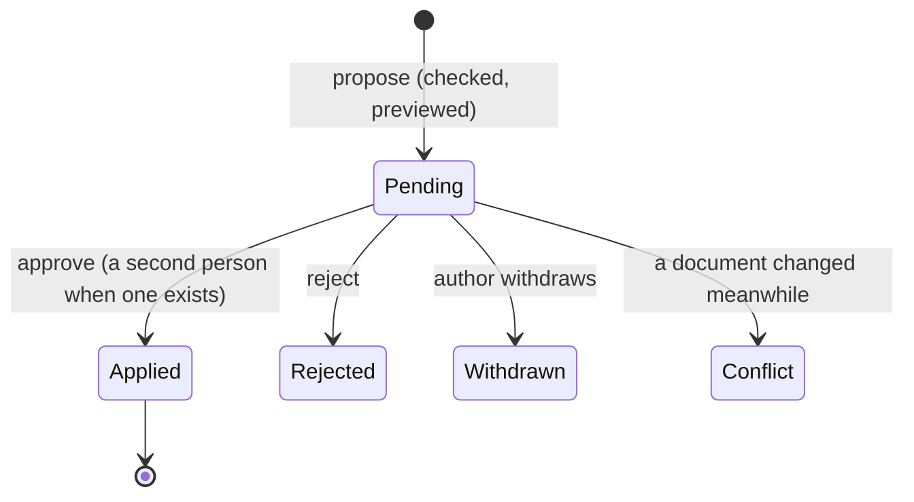
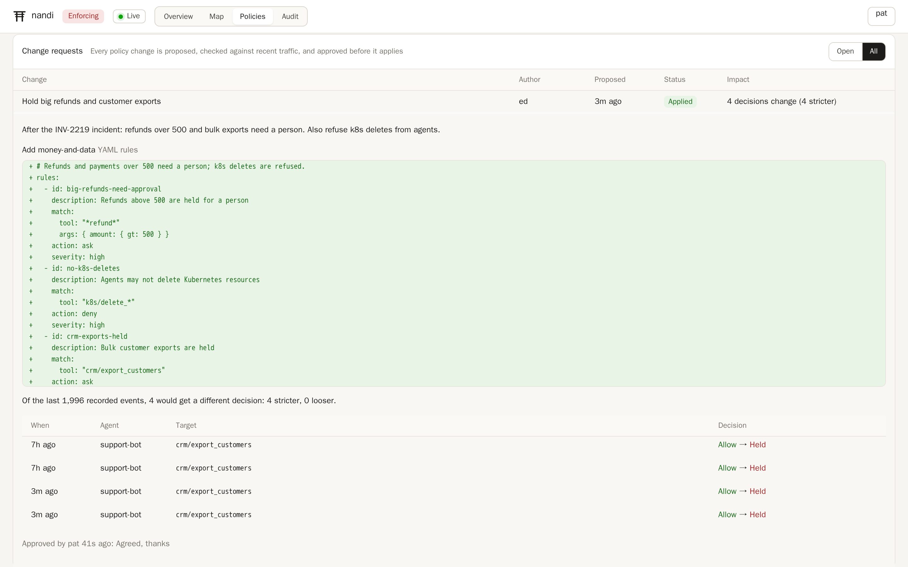

# Managing policy in the dashboard

Policy can live in files (`policy.rules`, `policy.cedar`), which suits Git
and configuration management, or be written in the dashboard's
**Policies** tab. Both compile into one policy set. Files are read-only in
the dashboard; documents written there change only through **change
requests**, so every change is checked, previewed against real traffic,
approved and recorded.

## Writing a policy

Open **Policies**, then **New policy**, a file to read it, or a
[policy pack](packs.md) to start from it. The editor takes
[YAML rules](rules.md) or [Cedar](cedar.md).

- **Check** compiles the document together with the policy files and the
  other documents, and lists errors and warnings, exactly as nandi would
  load them.
- **Preview impact** replays the most recent recorded events (2,000 by
  default) through the current policy and through the proposed one, each in
  a fresh engine, and lists every event whose decision would change:

  > Of the last 1,996 recorded events, 4 would get a different decision:
  > 4 stricter, 0 looser.

  The preview needs the audit log. Events are replayed without the
  sessions' earlier history, so session-dependent rules (sequences, taint,
  budgets) are approximate; identity groups are not replayed.

- **Propose change** opens a change request with a title and a reason.
  Existing documents also offer **Disable**, **Enable**, **Delete** and
  **History**; each of these is a change request too.

## Reviewing and applying

Change requests are listed under the editor with their author, status and
impact. Opening one shows its reason, a line diff of every document it
touches, the impact preview, and the reviews.

- **Approve and apply** (role `policy_approver` or `admin`) applies the
  change at once: the documents get new versions and the engine switches
  to the new policy for the next action.
- **Reject** closes it with a comment. The author can **Withdraw** it.
- **Two-person rule.** With `policy.changes.require_review` (the default),
  an author cannot approve their own change while someone else could: any
  other enabled user with `policy_approver` or `admin`, or the admin token.
  When nobody else could, as on a single-user laptop, the author applies
  it and the change says so.
- **Conflicts.** A change records the version of each document it touches.
  If one of them changed in the meantime, applying it is refused and the
  change is marked as a conflict; propose it again from the current text.





## History and rollback

Every applied change creates a version of each document. **History** lists
them; **Restore** loads an old version into the editor, and proposing it
rolls the policy back through the same review. Nothing is ever overwritten
without a change request.

## Who may do what

| | Viewer | Policy editor | Policy approver | Admin |
|---|---|---|---|---|
| Read policies, changes, history | yes | yes | yes | yes |
| Check, preview, propose | | yes | yes | yes |
| Approve and apply, reject | | | yes | yes |

Every proposal, approval, rejection and withdrawal is recorded in the
[audit trail](../operations/users.md#the-audit-trail) under the person who
did it.

## Fleets and locked policy

On machines with [managed settings](../operations/mdm.md), policy written
in the dashboard is off by default, so a laptop's dashboard cannot loosen
what IT deployed. IT can allow it as a managed setting:

```yaml
policy:
  changes:
    enabled: true          # documents and change requests (default: on, off with managed settings)
    require_review: true   # a second person approves, when one exists
    preview_events: 2000   # recorded events replayed by the impact preview
```

## API

The same operations are available on the [admin API](../reference/admin-api.md):

```sh
# Propose: a list of operations (put, delete, enable, disable).
curl -s -H "Authorization: Bearer $NANDI_TOKEN" -H 'content-type: application/json' \
  http://127.0.0.1:8788/v1/policies/changes -d '{
    "title": "Hold big refunds",
    "description": "After the INV-2219 incident",
    "ops": [{ "op": "put", "name": "refunds", "kind": "rules",
              "content": "rules:\n  - id: big-refunds\n    match: { tool: \"*refund*\", args: { amount: { gt: 500 } } }\n    action: ask\n" }]
  }' | jq '{id, status, impact}'

# Approve and apply it (as someone else).
curl -s -H "Authorization: Bearer $APPROVER_TOKEN" -X POST \
  http://127.0.0.1:8788/v1/policies/changes/<id>/approve -d '{"comment": "agreed"}'
```
